<!-- GENERATED by gen-registry.js from projects-repos.json. DO NOT EDIT. -->

# Repos tree

Root -> numbered groups -> hubs -> repos. Source: `repos-tree.json` (this folder). Graph notes: [[_git-repos-master]] (folder `repos-tree/`). Also `repos-tree.canvas`, `repos-tree.xml`, `repos-tree.html`.

## Tree

- **[[_git-repos-master]]** · 🌐 public · Repos
  - 📁 **1.1.Cloudy/** · Cloudy (1.1): hub cloudy-___ and its members. The cloudy project: fleet infrastructure, services, devices, data and docs.
    - **[[cloudy-___]]** · 🌐 public · Cloudy
      - [[cloudy_db_assets-cdn]] · 🌐 public · Cloudy
      - [[cloudy_db_infra-ops-obsv_configs-sync]] · 🌐 public · Cloudy
      - [[cloudy_db_LFS]] · 🔒 private · Cloudy
      - [[cloudy-a-docs]] · 🔒 private · Cloudy
      - [[cloudy-h-webapps]] · 🌐 public · Cloudy
      - [[cloudy-h-webapps-2]] · 🌐 public · Cloudy
      - [[cloudy-t-infra]] · 🌐 public · Cloudy
      - [[cloudy-u-android]] · 🌐 public · Cloudy
      - [[cloudy-u-containers]] · 🌐 public · Cloudy
      - [[cloudy-u-containers_cgc]] · 🌐 public · Cloudy
      - [[cloudy-u-desktop]] · 🌐 public · Cloudy
      - [[cloudy-u-linux]] · 🌐 public · Cloudy
  - 📁 **1.2.Cloud-me/** · Cloud-Me (1.2): hub cloud-me-___ and its members. The owner's personal cloud: public profiles and shared data, private configs, data and secrets.
    - **[[cloud-me-___]]** · 🌐 public · Cloud-Me
      - 📁 **Pub/**
        - **[[cloud-me-pub-___]]** · 🌐 public · Cloud-Me
          - 📁 **Profiles/**
            - **[[cloud-me-pub-profiles-___]]** · 🌐 public · Cloud-Me
              - [[cloud-me-pub-profiles-_lnktree]] · 🌐 public · Cloud-Me
              - [[cloud-me-pub-profiles-leaf.y]] · 🌐 public · Cloud-Me
              - [[cloud-me-pub-profiles-nexus.z]] · 🌐 public · Cloud-Me
              - [[cloud-me-pub-profiles-prf-prs]] · 🌐 public · Cloud-Me
              - [[cloud-me-pub-profiles-stark.x]] · 🌐 public · Cloud-Me
          - [[cloud-me-pub-shared]] · 🌐 public · Cloud-Me
      - 📁 **Pvt/**
        - **[[cloud-me-pvt-___]]** · 🌐 public · Cloud-Me
          - [[cloud-me-pvt-cgc]] · 🔒 private · Cloud-Me
          - [[cloud-me-pvt-configs]] · 🔒 private · Cloud-Me
          - [[cloud-me-pvt-containers]] · 🔒 private · Cloud-Me
          - [[cloud-me-pvt-data]] · 🔒 private · Cloud-Me
          - [[cloud-me-pvt-my-ai]] · 🔒 private · Cloud-Me
          - [[cloud-me-pvt-notes]] · 🔒 private · Cloud-Me
          - [[cloud-me-pvt-vault]] · 🔒 private · Cloud-Me
  - 📁 **2.CG/** · CG (2): hub CG-___ and its members. Computer graphics: 3D worlds, engines and media production.
    - **[[CG-___]]** · 🌐 public
      - [[CG-circus]] · 🌐 public · Zirkus
      - [[CG-galaxy]] · 🌐 public · Galaxy
      - [[CG-galaxy-gaia]] · 🔒 private · Galaxy
      - [[CG-unity]] · 🔒 private · Galaxy
      - [[CG-voxel-rust]] · 🌐 public · Galaxy
  - 📁 **3.Capital/** · Capital (3): hub Capital-___ and its members. Capital: capital markets and corporate finance. The hub Capital-___ is the area home (3.0).
    - **[[Capital-___]]** · 🌐 public
      - 📁 **Capital-Markets/**
        - [[Capital-Macro-Central-Bank]] · 🌐 public · Macro-Central-Bank
        - [[Capital-Stack-Fin-Terminal]] · 🌐 public · Stack-Fin-Terminal
      - 📁 **Corporate/**
        - [[Capital-Micro-Asset-Management]] · 🌐 public · Micro-Asset-Management
  - 📁 **4.HardTech/** · HardTech (4): hub HardTech-___ and its members. HardTech: deep science projects and CAD / simulation tools.
    - **[[HardTech-___]]** · 🌐 public
      - [[HardTech-DeepXTech]] · 🌐 public · DeepXTech
      - [[HardTech-Stack-CAD-Simulators]] · 🌐 public · Stack-CAD-Simulators
  - 📁 **5.Lecole-42/** · 42 (5): hub lecole-42-___ and its members. 42 school coursework (a school, not a project): one project per curriculum repo.
    - **[[lecole-42-___]]** · 🌐 public
      - [[lecole-42_back-Algo]] · 🌐 public · 42-algo
      - [[lecole-42_back-Graphic]] · 🌐 public · 42-graphic
      - [[lecole-42_back-System]] · 🌐 public · 42-system
      - [[lecole-42_cyber-Cyberwarfare]] · 🌐 public · 42-cyberwarfare
      - [[lecole-42_dev]] · 🔒 private · 42-dev
      - [[lecole-42_ml-Agentic]] · 🌐 public · 42-agentic
      - [[lecole-42_ml-DataScience]] · 🌐 public · 42-datascience
      - [[lecole-42_ml-MachineLearning]] · 🌐 public · 42-machinelearning
      - [[lecole-42_ops-Mylibs]] · 🌐 public · 42-mylibs
      - [[lecole-42-projects]] · 🔒 private · 42-projects
  - 📁 **6.Projects/** · Projects (6): hub Projects-___ and its members. Projects (formerly Front): endeavours, lab tools and DuckPeng.
    - **[[Projects-___]]** · 🌐 public
      - 📁 **DuckPeng/**
        - **[[DuckPeng-___]]** · 🌐 public · DuckPeng
      - [[Projects-endeavours]] · 🌐 public · Endeavours
  - 📁 **7.Others/** · Others (7): no hub. Loose GitHub repos with no project hub (profile README, GitHub Pages site).
    - [[diegonmarcos]] · 🌐 public · Profile
    - [[diegonmarcos.github.io]] · 🌐 public · Pages
  - 📁 **8.Archived/** · Archived (8): hub z-archived-___ and its members. Every z-archived_* repo, under the hub z-archived-___.
    - **[[z-archived-___]]** · 🌐 public
      - [[z-archived_c3-infra-plugin]] · 🔒 private · Z-archived
      - [[z-archived_cloud-me-pub-data]] · 🌐 public · Z-archived
      - [[z-archived_cloud-me-pvt-data-private]] · 🔒 private · Z-archived
      - [[z-archived_cloud-me-pvt-legacy]] · 🔒 private · Z-archived
      - [[z-archived_front-data]] · 🌐 public · Z-archived
      - [[z-archived_front-feeds]] · 🌐 public · Z-archived
      - [[z-archived_front-individual]] · 🌐 public · Z-archived
      - [[z-archived_front-linktree]] · 🌐 public · Z-archived
      - [[z-archived_front-media]] · 🌐 public · Z-archived
      - [[z-archived_front-others]] · 🌐 public · Z-archived
      - [[z-archived_front-projects]] · 🌐 public · Z-archived
      - [[z-archived_front-warehouse]] · 🌐 public · Z-archived
      - [[z-archived_My-ai-memory]] · 🔒 private · Z-archived
      - [[z-archived_Projects-labtools]] · 🌐 public · Z-archived

## Mermaid

```mermaid
graph LR
  n__git_repos_master["_git-repos-master"]
  n_group_1_1_Cloudy["1.1.Cloudy/"]
  n_cloudy____["cloudy-___"]
  n_cloudy_db_assets_cdn["cloudy_db_assets-cdn"]
  n_cloudy_db_infra_ops_obsv_configs_sync["cloudy_db_infra-ops-obsv_configs-sync"]
  n_cloudy_db_LFS["cloudy_db_LFS"]
  n_cloudy_a_docs["cloudy-a-docs"]
  n_cloudy_h_webapps["cloudy-h-webapps"]
  n_cloudy_h_webapps_2["cloudy-h-webapps-2"]
  n_cloudy_t_infra["cloudy-t-infra"]
  n_cloudy_u_android["cloudy-u-android"]
  n_cloudy_u_containers["cloudy-u-containers"]
  n_cloudy_u_containers_cgc["cloudy-u-containers_cgc"]
  n_cloudy_u_desktop["cloudy-u-desktop"]
  n_cloudy_u_linux["cloudy-u-linux"]
  n_group_1_2_Cloud_me["1.2.Cloud-me/"]
  n_cloud_me____["cloud-me-___"]
  n_group_1_2_Cloud_me_Pub["Pub/"]
  n_cloud_me_pub____["cloud-me-pub-___"]
  n_group_1_2_Cloud_me_Pub_Profiles["Profiles/"]
  n_cloud_me_pub_profiles____["cloud-me-pub-profiles-___"]
  n_cloud_me_pub_profiles__lnktree["cloud-me-pub-profiles-_lnktree"]
  n_cloud_me_pub_profiles_leaf_y["cloud-me-pub-profiles-leaf.y"]
  n_cloud_me_pub_profiles_nexus_z["cloud-me-pub-profiles-nexus.z"]
  n_cloud_me_pub_profiles_prf_prs["cloud-me-pub-profiles-prf-prs"]
  n_cloud_me_pub_profiles_stark_x["cloud-me-pub-profiles-stark.x"]
  n_cloud_me_pub_shared["cloud-me-pub-shared"]
  n_group_1_2_Cloud_me_Pvt["Pvt/"]
  n_cloud_me_pvt____["cloud-me-pvt-___"]
  n_cloud_me_pvt_cgc["cloud-me-pvt-cgc"]
  n_cloud_me_pvt_configs["cloud-me-pvt-configs"]
  n_cloud_me_pvt_containers["cloud-me-pvt-containers"]
  n_cloud_me_pvt_data["cloud-me-pvt-data"]
  n_cloud_me_pvt_my_ai["cloud-me-pvt-my-ai"]
  n_cloud_me_pvt_notes["cloud-me-pvt-notes"]
  n_cloud_me_pvt_vault["cloud-me-pvt-vault"]
  n_group_2_CG["2.CG/"]
  n_CG____["CG-___"]
  n_CG_circus["CG-circus"]
  n_CG_galaxy["CG-galaxy"]
  n_CG_galaxy_gaia["CG-galaxy-gaia"]
  n_CG_unity["CG-unity"]
  n_CG_voxel_rust["CG-voxel-rust"]
  n_group_3_Capital["3.Capital/"]
  n_Capital____["Capital-___"]
  n_group_3_Capital_Capital_Markets["Capital-Markets/"]
  n_Capital_Macro_Central_Bank["Capital-Macro-Central-Bank"]
  n_Capital_Stack_Fin_Terminal["Capital-Stack-Fin-Terminal"]
  n_group_3_Capital_Corporate["Corporate/"]
  n_Capital_Micro_Asset_Management["Capital-Micro-Asset-Management"]
  n_group_4_HardTech["4.HardTech/"]
  n_HardTech____["HardTech-___"]
  n_HardTech_DeepXTech["HardTech-DeepXTech"]
  n_HardTech_Stack_CAD_Simulators["HardTech-Stack-CAD-Simulators"]
  n_group_5_Lecole_42["5.Lecole-42/"]
  n_lecole_42____["lecole-42-___"]
  n_lecole_42_back_Algo["lecole-42_back-Algo"]
  n_lecole_42_back_Graphic["lecole-42_back-Graphic"]
  n_lecole_42_back_System["lecole-42_back-System"]
  n_lecole_42_cyber_Cyberwarfare["lecole-42_cyber-Cyberwarfare"]
  n_lecole_42_dev["lecole-42_dev"]
  n_lecole_42_ml_Agentic["lecole-42_ml-Agentic"]
  n_lecole_42_ml_DataScience["lecole-42_ml-DataScience"]
  n_lecole_42_ml_MachineLearning["lecole-42_ml-MachineLearning"]
  n_lecole_42_ops_Mylibs["lecole-42_ops-Mylibs"]
  n_lecole_42_projects["lecole-42-projects"]
  n_group_6_Projects["6.Projects/"]
  n_Projects____["Projects-___"]
  n_group_6_Projects_DuckPeng["DuckPeng/"]
  n_DuckPeng____["DuckPeng-___"]
  n_Projects_endeavours["Projects-endeavours"]
  n_group_7_Others["7.Others/"]
  n_diegonmarcos["diegonmarcos"]
  n_diegonmarcos_github_io["diegonmarcos.github.io"]
  n_group_8_Archived["8.Archived/"]
  n_z_archived____["z-archived-___"]
  n_z_archived_c3_infra_plugin["z-archived_c3-infra-plugin"]
  n_z_archived_cloud_me_pub_data["z-archived_cloud-me-pub-data"]
  n_z_archived_cloud_me_pvt_data_private["z-archived_cloud-me-pvt-data-private"]
  n_z_archived_cloud_me_pvt_legacy["z-archived_cloud-me-pvt-legacy"]
  n_z_archived_front_data["z-archived_front-data"]
  n_z_archived_front_feeds["z-archived_front-feeds"]
  n_z_archived_front_individual["z-archived_front-individual"]
  n_z_archived_front_linktree["z-archived_front-linktree"]
  n_z_archived_front_media["z-archived_front-media"]
  n_z_archived_front_others["z-archived_front-others"]
  n_z_archived_front_projects["z-archived_front-projects"]
  n_z_archived_front_warehouse["z-archived_front-warehouse"]
  n_z_archived_My_ai_memory["z-archived_My-ai-memory"]
  n_z_archived_Projects_labtools["z-archived_Projects-labtools"]
  n__git_repos_master --> n_group_1_1_Cloudy
  n_group_1_1_Cloudy --> n_cloudy____
  n_cloudy____ --> n_cloudy_db_assets_cdn
  n_cloudy____ --> n_cloudy_db_infra_ops_obsv_configs_sync
  n_cloudy____ --> n_cloudy_db_LFS
  n_cloudy____ --> n_cloudy_a_docs
  n_cloudy____ --> n_cloudy_h_webapps
  n_cloudy____ --> n_cloudy_h_webapps_2
  n_cloudy____ --> n_cloudy_t_infra
  n_cloudy____ --> n_cloudy_u_android
  n_cloudy____ --> n_cloudy_u_containers
  n_cloudy____ --> n_cloudy_u_containers_cgc
  n_cloudy____ --> n_cloudy_u_desktop
  n_cloudy____ --> n_cloudy_u_linux
  n__git_repos_master --> n_group_1_2_Cloud_me
  n_group_1_2_Cloud_me --> n_cloud_me____
  n_cloud_me____ --> n_group_1_2_Cloud_me_Pub
  n_group_1_2_Cloud_me_Pub --> n_cloud_me_pub____
  n_cloud_me_pub____ --> n_group_1_2_Cloud_me_Pub_Profiles
  n_group_1_2_Cloud_me_Pub_Profiles --> n_cloud_me_pub_profiles____
  n_cloud_me_pub_profiles____ --> n_cloud_me_pub_profiles__lnktree
  n_cloud_me_pub_profiles____ --> n_cloud_me_pub_profiles_leaf_y
  n_cloud_me_pub_profiles____ --> n_cloud_me_pub_profiles_nexus_z
  n_cloud_me_pub_profiles____ --> n_cloud_me_pub_profiles_prf_prs
  n_cloud_me_pub_profiles____ --> n_cloud_me_pub_profiles_stark_x
  n_cloud_me_pub____ --> n_cloud_me_pub_shared
  n_cloud_me____ --> n_group_1_2_Cloud_me_Pvt
  n_group_1_2_Cloud_me_Pvt --> n_cloud_me_pvt____
  n_cloud_me_pvt____ --> n_cloud_me_pvt_cgc
  n_cloud_me_pvt____ --> n_cloud_me_pvt_configs
  n_cloud_me_pvt____ --> n_cloud_me_pvt_containers
  n_cloud_me_pvt____ --> n_cloud_me_pvt_data
  n_cloud_me_pvt____ --> n_cloud_me_pvt_my_ai
  n_cloud_me_pvt____ --> n_cloud_me_pvt_notes
  n_cloud_me_pvt____ --> n_cloud_me_pvt_vault
  n__git_repos_master --> n_group_2_CG
  n_group_2_CG --> n_CG____
  n_CG____ --> n_CG_circus
  n_CG____ --> n_CG_galaxy
  n_CG____ --> n_CG_galaxy_gaia
  n_CG____ --> n_CG_unity
  n_CG____ --> n_CG_voxel_rust
  n__git_repos_master --> n_group_3_Capital
  n_group_3_Capital --> n_Capital____
  n_Capital____ --> n_group_3_Capital_Capital_Markets
  n_group_3_Capital_Capital_Markets --> n_Capital_Macro_Central_Bank
  n_group_3_Capital_Capital_Markets --> n_Capital_Stack_Fin_Terminal
  n_Capital____ --> n_group_3_Capital_Corporate
  n_group_3_Capital_Corporate --> n_Capital_Micro_Asset_Management
  n__git_repos_master --> n_group_4_HardTech
  n_group_4_HardTech --> n_HardTech____
  n_HardTech____ --> n_HardTech_DeepXTech
  n_HardTech____ --> n_HardTech_Stack_CAD_Simulators
  n__git_repos_master --> n_group_5_Lecole_42
  n_group_5_Lecole_42 --> n_lecole_42____
  n_lecole_42____ --> n_lecole_42_back_Algo
  n_lecole_42____ --> n_lecole_42_back_Graphic
  n_lecole_42____ --> n_lecole_42_back_System
  n_lecole_42____ --> n_lecole_42_cyber_Cyberwarfare
  n_lecole_42____ --> n_lecole_42_dev
  n_lecole_42____ --> n_lecole_42_ml_Agentic
  n_lecole_42____ --> n_lecole_42_ml_DataScience
  n_lecole_42____ --> n_lecole_42_ml_MachineLearning
  n_lecole_42____ --> n_lecole_42_ops_Mylibs
  n_lecole_42____ --> n_lecole_42_projects
  n__git_repos_master --> n_group_6_Projects
  n_group_6_Projects --> n_Projects____
  n_Projects____ --> n_group_6_Projects_DuckPeng
  n_group_6_Projects_DuckPeng --> n_DuckPeng____
  n_Projects____ --> n_Projects_endeavours
  n__git_repos_master --> n_group_7_Others
  n_group_7_Others --> n_diegonmarcos
  n_group_7_Others --> n_diegonmarcos_github_io
  n__git_repos_master --> n_group_8_Archived
  n_group_8_Archived --> n_z_archived____
  n_z_archived____ --> n_z_archived_c3_infra_plugin
  n_z_archived____ --> n_z_archived_cloud_me_pub_data
  n_z_archived____ --> n_z_archived_cloud_me_pvt_data_private
  n_z_archived____ --> n_z_archived_cloud_me_pvt_legacy
  n_z_archived____ --> n_z_archived_front_data
  n_z_archived____ --> n_z_archived_front_feeds
  n_z_archived____ --> n_z_archived_front_individual
  n_z_archived____ --> n_z_archived_front_linktree
  n_z_archived____ --> n_z_archived_front_media
  n_z_archived____ --> n_z_archived_front_others
  n_z_archived____ --> n_z_archived_front_projects
  n_z_archived____ --> n_z_archived_front_warehouse
  n_z_archived____ --> n_z_archived_My_ai_memory
  n_z_archived____ --> n_z_archived_Projects_labtools
```



## Dataview

```dataview
TABLE group, hub, project, area, family, visibility, developer
FROM "0_repos-tree/repos-tree" AND #repo
SORT group ASC, file.name ASC
```
