<!-- GENERATED by gen-repos-tree.js from repos.json + repos-github.json. DO NOT EDIT. -->

# Repos tree

Graph notes: [[_git-repos-master]] (folder `repos-tree/`). Canvas: `repos-tree.canvas`. Also `repos-tree.json`, `repos-tree.xml`, `repos-tree.html`.

## Tree

- **[[_git-repos-master]]** · 🌐 public · Repos
  - **[[cloud-me-___]]** · 🌐 public · Cloud-Me
    - **[[cloud-me-pub-___]]** · 🌐 public · Cloud-Me
      - **[[cloud-me-pub-profiles-___]]** · 🌐 public · Cloud-Me
        - [[cloud-me-pub-profiles-_lnktree]] · 🌐 public · Cloud-Me
        - [[cloud-me-pub-profiles-leaf.y]] · 🌐 public · Cloud-Me
        - [[cloud-me-pub-profiles-nexus.z]] · 🌐 public · Cloud-Me
        - [[cloud-me-pub-profiles-prf-prs]] · 🌐 public · Cloud-Me
        - [[cloud-me-pub-profiles-stark.x]] · 🌐 public · Cloud-Me
      - [[cloud-me-pub-shared]] · 🌐 public · Cloud-Me
    - **[[cloud-me-pvt-___]]** · 🌐 public · Cloud-Me
      - [[cloud-me-pvt-cgc]] · 🔒 private · Cloud-Me
      - [[cloud-me-pvt-configs]] · 🔒 private · Cloud-Me
      - [[cloud-me-pvt-containers]] · 🔒 private · Cloud-Me
      - [[cloud-me-pvt-data]] · 🔒 private · Cloud-Me
      - [[cloud-me-pvt-my-ai]] · 🔒 private · Cloud-Me
      - [[cloud-me-pvt-notes]] · 🔒 private · Cloud-Me
      - [[cloud-me-pvt-vault]] · 🔒 private · Cloud-Me
  - **[[cloudy-___]]** · 🌐 public · Cloudy
    - [[cloudy_db_assets-cdn]] · 🌐 public · Cloudy
    - [[cloudy_db_infra-ops-obsv_configs-sync]] · 🌐 public · Cloudy
    - [[cloudy_db_LFS]] · 🔒 private · Cloudy
    - [[cloudy-a-docs]] · 🔒 private · Cloudy
    - [[cloudy-h-webapps]] · 🌐 public · Cloudy
    - [[cloudy-h-webapps-2]] · 🌐 public · Cloudy
    - [[cloudy-t-infra]] · 🌐 public · Cloudy
    - [[cloudy-u-android]] · 🌐 public · Cloudy
    - [[cloudy-u-containers]] · 🌐 public · Cloudy
    - [[cloudy-u-containers_cgc]] · 🌐 public · Cloudy
    - [[cloudy-u-desktop]] · 🌐 public · Cloudy
    - [[cloudy-u-linux]] · 🌐 public · Cloudy
  - **[[lecole-42-___]]** · 🌐 public
    - [[lecole-42_back-Algo]] · 🌐 public · 42-algo
    - [[lecole-42_back-Graphic]] · 🌐 public · 42-graphic
    - [[lecole-42_back-System]] · 🌐 public · 42-system
    - [[lecole-42_cyber-Cyberwarfare]] · 🌐 public · 42-cyberwarfare
    - [[lecole-42_dev]] · 🔒 private · 42-dev
    - [[lecole-42_ml-Agentic]] · 🌐 public · 42-agentic
    - [[lecole-42_ml-DataScience]] · 🌐 public · 42-datascience
    - [[lecole-42_ml-MachineLearning]] · 🌐 public · 42-machinelearning
    - [[lecole-42_ops-Mylibs]] · 🌐 public · 42-mylibs
    - [[lecole-42-projects]] · 🔒 private · 42-projects
  - **[[Projects-___]]** · 🌐 public
    - **[[CG-___]]** · 🌐 public
      - [[CG-circus]] · 🌐 public · Zirkus
      - [[CG-galaxy]] · 🌐 public · Galaxy
      - [[CG-galaxy-gaia]] · 🔒 private · Galaxy
      - [[CG-unity]] · 🔒 private · Galaxy
      - [[CG-voxel-rust]] · 🌐 public · Galaxy
    - **[[DeepSc-___]]** · 🌐 public
      - [[CAD-Simulators]] · 🌐 public · CAD-Simulators
      - [[DeepSc-X]] · 🌐 public · DeepSc-X
    - **[[DuckPeng-___]]** · 🌐 public
    - **[[Fin-___]]** · 🌐 public · Fin-CM
      - [[Fin-CM-Blmbrg]] · 🌐 public · Fin-CM
      - [[Fin-CM-mqpm]] · 🌐 public · Fin-CM
      - [[Fin-Corporate]] · 🌐 public · Fin-CM
    - [[diegonmarcos]] · 🌐 public · Profile
    - [[diegonmarcos.github.io]] · 🌐 public · Pages
    - [[Projects-endeavours]] · 🌐 public · Endeavours
    - [[Projects-labtools]] · 🌐 public · Labtools
  - [[z-archived_c3-infra-plugin]] · 🔒 private
  - [[z-archived_cloud-me-pub-data]] · 🌐 public
  - [[z-archived_cloud-me-pvt-data-private]] · 🔒 private
  - [[z-archived_cloud-me-pvt-legacy]] · 🔒 private
  - [[z-archived_front-data]] · 🌐 public
  - [[z-archived_front-feeds]] · 🌐 public
  - [[z-archived_front-individual]] · 🌐 public
  - [[z-archived_front-linktree]] · 🌐 public
  - [[z-archived_front-media]] · 🌐 public
  - [[z-archived_front-others]] · 🌐 public
  - [[z-archived_front-projects]] · 🌐 public
  - [[z-archived_front-warehouse]] · 🌐 public
  - [[z-archived_My-ai-memory]] · 🔒 private

## Mermaid

```mermaid
graph LR
  n__git_repos_master["_git-repos-master"]
  n_cloudy____["cloudy-___"]
  n_cloudy_u_android["cloudy-u-android"]
  n_cloudy_t_infra["cloudy-t-infra"]
  n_cloudy_u_containers["cloudy-u-containers"]
  n_cloudy_u_containers_cgc["cloudy-u-containers_cgc"]
  n_cloudy_db_assets_cdn["cloudy_db_assets-cdn"]
  n_cloudy_db_infra_ops_obsv_configs_sync["cloudy_db_infra-ops-obsv_configs-sync"]
  n_cloudy_db_LFS["cloudy_db_LFS"]
  n_cloudy_u_desktop["cloudy-u-desktop"]
  n_cloudy_a_docs["cloudy-a-docs"]
  n_cloudy_u_linux["cloudy-u-linux"]
  n_cloudy_h_webapps["cloudy-h-webapps"]
  n_cloudy_h_webapps_2["cloudy-h-webapps-2"]
  n_cloud_me____["cloud-me-___"]
  n_cloud_me_pub____["cloud-me-pub-___"]
  n_cloud_me_pub_profiles____["cloud-me-pub-profiles-___"]
  n_cloud_me_pub_profiles__lnktree["cloud-me-pub-profiles-_lnktree"]
  n_cloud_me_pub_profiles_leaf_y["cloud-me-pub-profiles-leaf.y"]
  n_cloud_me_pub_profiles_nexus_z["cloud-me-pub-profiles-nexus.z"]
  n_cloud_me_pub_profiles_prf_prs["cloud-me-pub-profiles-prf-prs"]
  n_cloud_me_pub_profiles_stark_x["cloud-me-pub-profiles-stark.x"]
  n_cloud_me_pub_shared["cloud-me-pub-shared"]
  n_cloud_me_pvt____["cloud-me-pvt-___"]
  n_cloud_me_pvt_my_ai["cloud-me-pvt-my-ai"]
  n_cloud_me_pvt_cgc["cloud-me-pvt-cgc"]
  n_cloud_me_pvt_configs["cloud-me-pvt-configs"]
  n_cloud_me_pvt_containers["cloud-me-pvt-containers"]
  n_cloud_me_pvt_data["cloud-me-pvt-data"]
  n_cloud_me_pvt_notes["cloud-me-pvt-notes"]
  n_cloud_me_pvt_vault["cloud-me-pvt-vault"]
  n_CG____["CG-___"]
  n_CG_galaxy["CG-galaxy"]
  n_CG_galaxy_gaia["CG-galaxy-gaia"]
  n_CG_unity["CG-unity"]
  n_CG_voxel_rust["CG-voxel-rust"]
  n_CG_circus["CG-circus"]
  n_DuckPeng____["DuckPeng-___"]
  n_Fin_Corporate["Fin-Corporate"]
  n_Fin_CM_Blmbrg["Fin-CM-Blmbrg"]
  n_Fin_CM_mqpm["Fin-CM-mqpm"]
  n_Fin____["Fin-___"]
  n_DeepSc____["DeepSc-___"]
  n_DeepSc_X["DeepSc-X"]
  n_CAD_Simulators["CAD-Simulators"]
  n_lecole_42_back_Algo["lecole-42_back-Algo"]
  n_lecole_42_back_Graphic["lecole-42_back-Graphic"]
  n_lecole_42____["lecole-42-___"]
  n_lecole_42_ops_Mylibs["lecole-42_ops-Mylibs"]
  n_lecole_42_projects["lecole-42-projects"]
  n_lecole_42_back_System["lecole-42_back-System"]
  n_lecole_42_ml_Agentic["lecole-42_ml-Agentic"]
  n_lecole_42_ml_DataScience["lecole-42_ml-DataScience"]
  n_lecole_42_ml_MachineLearning["lecole-42_ml-MachineLearning"]
  n_lecole_42_cyber_Cyberwarfare["lecole-42_cyber-Cyberwarfare"]
  n_lecole_42_dev["lecole-42_dev"]
  n_Projects____["Projects-___"]
  n_Projects_endeavours["Projects-endeavours"]
  n_Projects_labtools["Projects-labtools"]
  n_diegonmarcos["diegonmarcos"]
  n_diegonmarcos_github_io["diegonmarcos.github.io"]
  n_z_archived_c3_infra_plugin["z-archived_c3-infra-plugin"]
  n_z_archived_cloud_me_pub_data["z-archived_cloud-me-pub-data"]
  n_z_archived_cloud_me_pvt_data_private["z-archived_cloud-me-pvt-data-private"]
  n_z_archived_cloud_me_pvt_legacy["z-archived_cloud-me-pvt-legacy"]
  n_z_archived_front_data["z-archived_front-data"]
  n_z_archived_front_feeds["z-archived_front-feeds"]
  n_z_archived_front_individual["z-archived_front-individual"]
  n_z_archived_front_linktree["z-archived_front-linktree"]
  n_z_archived_front_media["z-archived_front-media"]
  n_z_archived_front_others["z-archived_front-others"]
  n_z_archived_front_projects["z-archived_front-projects"]
  n_z_archived_front_warehouse["z-archived_front-warehouse"]
  n_z_archived_My_ai_memory["z-archived_My-ai-memory"]
  n__git_repos_master --> n_cloudy____
  n_cloudy____ --> n_cloudy_u_android
  n_cloudy____ --> n_cloudy_t_infra
  n_cloudy____ --> n_cloudy_u_containers
  n_cloudy____ --> n_cloudy_u_containers_cgc
  n_cloudy____ --> n_cloudy_db_assets_cdn
  n_cloudy____ --> n_cloudy_db_infra_ops_obsv_configs_sync
  n_cloudy____ --> n_cloudy_db_LFS
  n_cloudy____ --> n_cloudy_u_desktop
  n_cloudy____ --> n_cloudy_a_docs
  n_cloudy____ --> n_cloudy_u_linux
  n_cloudy____ --> n_cloudy_h_webapps
  n_cloudy____ --> n_cloudy_h_webapps_2
  n__git_repos_master --> n_cloud_me____
  n_cloud_me____ --> n_cloud_me_pub____
  n_cloud_me_pub____ --> n_cloud_me_pub_profiles____
  n_cloud_me_pub_profiles____ --> n_cloud_me_pub_profiles__lnktree
  n_cloud_me_pub_profiles____ --> n_cloud_me_pub_profiles_leaf_y
  n_cloud_me_pub_profiles____ --> n_cloud_me_pub_profiles_nexus_z
  n_cloud_me_pub_profiles____ --> n_cloud_me_pub_profiles_prf_prs
  n_cloud_me_pub_profiles____ --> n_cloud_me_pub_profiles_stark_x
  n_cloud_me_pub____ --> n_cloud_me_pub_shared
  n_cloud_me____ --> n_cloud_me_pvt____
  n_cloud_me_pvt____ --> n_cloud_me_pvt_my_ai
  n_cloud_me_pvt____ --> n_cloud_me_pvt_cgc
  n_cloud_me_pvt____ --> n_cloud_me_pvt_configs
  n_cloud_me_pvt____ --> n_cloud_me_pvt_containers
  n_cloud_me_pvt____ --> n_cloud_me_pvt_data
  n_cloud_me_pvt____ --> n_cloud_me_pvt_notes
  n_cloud_me_pvt____ --> n_cloud_me_pvt_vault
  n_Projects____ --> n_CG____
  n_CG____ --> n_CG_galaxy
  n_CG____ --> n_CG_galaxy_gaia
  n_CG____ --> n_CG_unity
  n_CG____ --> n_CG_voxel_rust
  n_CG____ --> n_CG_circus
  n_Projects____ --> n_DuckPeng____
  n_Fin____ --> n_Fin_Corporate
  n_Fin____ --> n_Fin_CM_Blmbrg
  n_Fin____ --> n_Fin_CM_mqpm
  n_Projects____ --> n_Fin____
  n_Projects____ --> n_DeepSc____
  n_DeepSc____ --> n_DeepSc_X
  n_DeepSc____ --> n_CAD_Simulators
  n_lecole_42____ --> n_lecole_42_back_Algo
  n_lecole_42____ --> n_lecole_42_back_Graphic
  n__git_repos_master --> n_lecole_42____
  n_lecole_42____ --> n_lecole_42_ops_Mylibs
  n_lecole_42____ --> n_lecole_42_projects
  n_lecole_42____ --> n_lecole_42_back_System
  n_lecole_42____ --> n_lecole_42_ml_Agentic
  n_lecole_42____ --> n_lecole_42_ml_DataScience
  n_lecole_42____ --> n_lecole_42_ml_MachineLearning
  n_lecole_42____ --> n_lecole_42_cyber_Cyberwarfare
  n_lecole_42____ --> n_lecole_42_dev
  n__git_repos_master --> n_Projects____
  n_Projects____ --> n_Projects_endeavours
  n_Projects____ --> n_Projects_labtools
  n_Projects____ --> n_diegonmarcos
  n_Projects____ --> n_diegonmarcos_github_io
  n__git_repos_master --> n_z_archived_c3_infra_plugin
  n__git_repos_master --> n_z_archived_cloud_me_pub_data
  n__git_repos_master --> n_z_archived_cloud_me_pvt_data_private
  n__git_repos_master --> n_z_archived_cloud_me_pvt_legacy
  n__git_repos_master --> n_z_archived_front_data
  n__git_repos_master --> n_z_archived_front_feeds
  n__git_repos_master --> n_z_archived_front_individual
  n__git_repos_master --> n_z_archived_front_linktree
  n__git_repos_master --> n_z_archived_front_media
  n__git_repos_master --> n_z_archived_front_others
  n__git_repos_master --> n_z_archived_front_projects
  n__git_repos_master --> n_z_archived_front_warehouse
  n__git_repos_master --> n_z_archived_My_ai_memory
```



## Dataview

```dataview
TABLE hub, project, area, family, visibility, developer
FROM "repos-tree" AND #repo
SORT hub ASC, file.name ASC
```
