<!-- generated by build.sh - edit the sources in A0_repos-tree/src or A1_repos-tree-folders/src (master: 0_registry/projects-repos.json), never this copy -->

<!-- GENERATED by gen-registry.js from projects-repos.json. DO NOT EDIT. Template: A0_repos-tree/src/repos-tree.md.tmpl -->

# Repos tree

Root -> numbered groups -> hubs -> repos. Source: `repos-tree.json` (this folder). Graph notes: [[_git-repos-master]] (folder `repos-tree/`). Also `repos-tree.canvas`, `repos-tree.xml`, `repos-tree.html`.
Every repo has a `kind`: `html` (a front/web page repo, mounted in `_front-html___`), `lfs` (uses Git LFS) or `code`; the columns "HTML repo?" and "LFS repo?" carry the two flags. Re-run the scan with `node 0_registry/scan-kinds.js`.

## Tree

### Full list (79 repos)

- **[[_git-repos-master]]** · 🌐 public · Repos · 💻 code
  - 📁 **1.1.Cloudy/** · Cloudy (1.1): hub cloudy-___ and its members. The cloudy project: fleet infrastructure, services, devices, data and docs.
    - **[[cloudy-___]]** · 🌐 public · Cloudy · 💻 code
      - [[cloudy_db_assets-cdn]] · 🌐 public · Cloudy · 💻 code
      - [[cloudy_db_infra-ops-obsv_configs-sync]] · 🌐 public · Cloudy · 💻 code
      - [[cloudy_db_LFS]] · 🔒 private · Cloudy · 📦 LFS
      - [[cloudy-a-docs]] · 🔒 private · Cloudy · 💻 code
      - [[cloudy-h-webapps-desk]] · 🌐 public · Cloudy · 🌐 HTML
      - [[cloudy-h-webapps-mob]] · 🌐 public · Cloudy · 🌐 HTML
      - [[cloudy-t-infra]] · 🌐 public · Cloudy · 💻 code
      - [[cloudy-u-android]] · 🌐 public · Cloudy · 💻 code
      - [[cloudy-u-containers]] · 🌐 public · Cloudy · 💻 code
      - [[cloudy-u-containers_cgc]] · 🌐 public · Cloudy · 💻 code
      - [[cloudy-u-desktop]] · 🌐 public · Cloudy · 💻 code
      - [[cloudy-u-linux]] · 🌐 public · Cloudy · 💻 code
  - 📁 **1.2.Cloud-me/** · Cloud-Me (1.2): hub cloud-me-___ and its members. The owner's personal cloud: public profiles and shared data, private configs, data and secrets.
    - **[[cloud-me-___]]** · 🌐 public · Cloud-Me · 💻 code
      - 📁 **Pub/**
        - **[[cloud-me-pub-___]]** · 🌐 public · Cloud-Me · 💻 code
          - 📁 **Profiles/**
            - **[[cloud-me-pub-profiles-___]]** · 🌐 public · Cloud-Me · 💻 code
              - [[cloud-me-pub-profiles-_lnktree]] · 🌐 public · Cloud-Me · 🌐 HTML
              - [[cloud-me-pub-profiles-leaf.y]] · 🌐 public · Cloud-Me · 🌐 HTML
              - [[cloud-me-pub-profiles-nexus.z]] · 🌐 public · Cloud-Me · 🌐 HTML
              - [[cloud-me-pub-profiles-prf-prs]] · 🌐 public · Cloud-Me · 🌐 HTML
              - [[cloud-me-pub-profiles-stark.x]] · 🌐 public · Cloud-Me · 🌐 HTML
          - [[cloud-me-pub-shared]] · 🌐 public · Cloud-Me · 💻 code
      - 📁 **Pvt/**
        - **[[cloud-me-pvt-___]]** · 🌐 public · Cloud-Me · 💻 code
          - [[cloud-me-pvt-cgc]] · 🔒 private · Cloud-Me · 💻 code
          - [[cloud-me-pvt-configs]] · 🔒 private · Cloud-Me · 💻 code
          - [[cloud-me-pvt-data]] · 🔒 private · Cloud-Me · 💻 code
          - [[cloud-me-pvt-my-ai]] · 🔒 private · Cloud-Me · 💻 code
          - [[cloud-me-pvt-notes]] · 🔒 private · Cloud-Me · 💻 code
          - [[cloud-me-pvt-tasks]] · 🔒 private · Cloud-Me · 💻 code
          - [[cloud-me-pvt-vault]] · 🔒 private · Cloud-Me · 💻 code
  - 📁 **2.CG/** · CG (2): hub CG-___ and its members. Computer graphics: 3D worlds, engines and media production.
    - **[[CG-___]]** · 🌐 public · 💻 code
      - [[CG-circus]] · 🌐 public · Zirkus · 🌐 HTML
      - [[CG-galaxy]] · 🌐 public · Galaxy · 🌐 HTML
      - [[CG-galaxy-gaia]] · 🔒 private · Galaxy · 🌐 HTML
      - [[CG-unity]] · 🔒 private · Galaxy · 💻 code
      - [[CG-voxel-rust]] · 🌐 public · Galaxy · 💻 code
  - 📁 **3.Capital/** · Capital (3): hub Capital-___ and its members. Capital: capital markets and corporate finance. The hub Capital-___ is the area home (3.0).
    - **[[Capital-___]]** · 🌐 public · 💻 code
      - 📁 **Capital-Markets/**
        - [[Capital-Macro-Central-Bank]] · 🌐 public · Macro-Central-Bank · 💻 code
        - [[Capital-Stack-Fin-Terminal]] · 🌐 public · Stack-Fin-Terminal · 💻 code
      - 📁 **Corporate/**
        - [[Capital-Micro-Asset-Management]] · 🌐 public · Micro-Asset-Management · 💻 code
  - 📁 **4.HardTech/** · HardTech (4): hub HardTech-___ and its members. HardTech: deep science projects and CAD / simulation tools.
    - **[[HardTech-___]]** · 🌐 public · 💻 code
      - [[HardTech-DeepXTech]] · 🌐 public · DeepXTech · 🌐 HTML
      - [[HardTech-Stack-CAD-Simulators]] · 🌐 public · Stack-CAD-Simulators · 💻 code
  - 📁 **5.Lecole-42/** · 42 (5): hub lecole-42-___ and its members. 42 school coursework (a school, not a project): one project per curriculum repo.
    - **[[lecole-42-___]]** · 🌐 public · 💻 code
      - [[lecole-42_back-Algo]] · 🌐 public · 42-algo · 💻 code
      - [[lecole-42_back-Graphic]] · 🌐 public · 42-graphic · 💻 code
      - [[lecole-42_back-System]] · 🌐 public · 42-system · 💻 code
      - [[lecole-42_cyber-Cyberwarfare]] · 🌐 public · 42-cyberwarfare · 💻 code
      - [[lecole-42_dev]] · 🔒 private · 42-dev · 💻 code
      - [[lecole-42_ml-Agentic]] · 🌐 public · 42-agentic · 💻 code
      - [[lecole-42_ml-DataScience]] · 🌐 public · 42-datascience · 💻 code
      - [[lecole-42_ml-MachineLearning]] · 🌐 public · 42-machinelearning · 💻 code
      - [[lecole-42_ops-Mylibs]] · 🌐 public · 42-mylibs · 💻 code
      - [[lecole-42-projects]] · 🔒 private · 42-projects · 💻 code
  - 📁 **6.Projects/** · Projects (6): hub Projects-___ and its members. Projects (formerly Front): endeavours, lab tools and DuckPeng.
    - **[[Projects-___]]** · 🌐 public · 💻 code
      - 📁 **DuckPeng/**
        - **[[DuckPeng-___]]** · 🌐 public · DuckPeng · 💻 code
      - [[Projects-endeavours]] · 🌐 public · Endeavours · 🌐 HTML
      - [[Projects-Library-KG]] · 🌐 public · Library-KG · 🌐 HTML
  - 📁 **7.Others/** · Others (7): no hub. Loose GitHub repos with no project hub (profile README, GitHub Pages site).
    - [[_front-html___]] · 🌐 public · Pages · 🌐 HTML
    - [[_git-lfs____]] · 🔒 private · Pages · 📦 LFS
    - [[diegonmarcos]] · 🌐 public · Profile · 🌐 HTML
    - [[diegonmarcos.github.io]] · 🌐 public · Pages · 🌐 HTML
  - 📁 **8.Archived/** · Archived (8): hub z-archived-___ and its members. Every z-archived_* repo, under the hub z-archived-___.
    - **[[z-archived-___]]** · 🌐 public · 💻 code
      - [[z-archived_c3-infra-plugin]] · 🔒 private · Z-archived · 💻 code
      - [[z-archived_cloud-me-pub-data]] · 🌐 public · Z-archived · 💻 code
      - [[z-archived_cloud-me-pvt-containers]] · 🔒 private · Z-archived · 💻 code
      - [[z-archived_cloud-me-pvt-data-private]] · 🔒 private · Z-archived · 💻 code
      - [[z-archived_cloud-me-pvt-legacy]] · 🔒 private · Z-archived · 💻 code
      - [[z-archived_front-data]] · 🌐 public · Z-archived · 💻 code
      - [[z-archived_front-feeds]] · 🌐 public · Z-archived · 💻 code
      - [[z-archived_front-individual]] · 🌐 public · Z-archived · 💻 code
      - [[z-archived_front-linktree]] · 🌐 public · Z-archived · 💻 code
      - [[z-archived_front-media]] · 🌐 public · Z-archived · 💻 code
      - [[z-archived_front-others]] · 🌐 public · Z-archived · 💻 code
      - [[z-archived_front-projects]] · 🌐 public · Z-archived · 💻 code
      - [[z-archived_front-warehouse]] · 🌐 public · Z-archived · 💻 code
      - [[z-archived_My-ai-memory]] · 🔒 private · Z-archived · 💻 code
      - [[z-archived_Projects-labtools]] · 🌐 public · Z-archived · 💻 code

### HTML repos (16)

- **[[_git-repos-master]]** · 🌐 public · Repos · 💻 code
  - 📁 **1.1.Cloudy/** · Cloudy (1.1): hub cloudy-___ and its members. The cloudy project: fleet infrastructure, services, devices, data and docs.
    - **[[cloudy-___]]** · 🌐 public · Cloudy · 💻 code
      - [[cloudy-h-webapps-desk]] · 🌐 public · Cloudy · 🌐 HTML
      - [[cloudy-h-webapps-mob]] · 🌐 public · Cloudy · 🌐 HTML
  - 📁 **1.2.Cloud-me/** · Cloud-Me (1.2): hub cloud-me-___ and its members. The owner's personal cloud: public profiles and shared data, private configs, data and secrets.
    - **[[cloud-me-___]]** · 🌐 public · Cloud-Me · 💻 code
      - 📁 **Pub/**
        - **[[cloud-me-pub-___]]** · 🌐 public · Cloud-Me · 💻 code
          - 📁 **Profiles/**
            - **[[cloud-me-pub-profiles-___]]** · 🌐 public · Cloud-Me · 💻 code
              - [[cloud-me-pub-profiles-_lnktree]] · 🌐 public · Cloud-Me · 🌐 HTML
              - [[cloud-me-pub-profiles-leaf.y]] · 🌐 public · Cloud-Me · 🌐 HTML
              - [[cloud-me-pub-profiles-nexus.z]] · 🌐 public · Cloud-Me · 🌐 HTML
              - [[cloud-me-pub-profiles-prf-prs]] · 🌐 public · Cloud-Me · 🌐 HTML
              - [[cloud-me-pub-profiles-stark.x]] · 🌐 public · Cloud-Me · 🌐 HTML
  - 📁 **2.CG/** · CG (2): hub CG-___ and its members. Computer graphics: 3D worlds, engines and media production.
    - **[[CG-___]]** · 🌐 public · 💻 code
      - [[CG-circus]] · 🌐 public · Zirkus · 🌐 HTML
      - [[CG-galaxy]] · 🌐 public · Galaxy · 🌐 HTML
      - [[CG-galaxy-gaia]] · 🔒 private · Galaxy · 🌐 HTML
  - 📁 **4.HardTech/** · HardTech (4): hub HardTech-___ and its members. HardTech: deep science projects and CAD / simulation tools.
    - **[[HardTech-___]]** · 🌐 public · 💻 code
      - [[HardTech-DeepXTech]] · 🌐 public · DeepXTech · 🌐 HTML
  - 📁 **6.Projects/** · Projects (6): hub Projects-___ and its members. Projects (formerly Front): endeavours, lab tools and DuckPeng.
    - **[[Projects-___]]** · 🌐 public · 💻 code
      - [[Projects-endeavours]] · 🌐 public · Endeavours · 🌐 HTML
      - [[Projects-Library-KG]] · 🌐 public · Library-KG · 🌐 HTML
  - 📁 **7.Others/** · Others (7): no hub. Loose GitHub repos with no project hub (profile README, GitHub Pages site).
    - [[_front-html___]] · 🌐 public · Pages · 🌐 HTML
    - [[diegonmarcos]] · 🌐 public · Profile · 🌐 HTML
    - [[diegonmarcos.github.io]] · 🌐 public · Pages · 🌐 HTML

### LFS repos (2)

- **[[_git-repos-master]]** · 🌐 public · Repos · 💻 code
  - 📁 **1.1.Cloudy/** · Cloudy (1.1): hub cloudy-___ and its members. The cloudy project: fleet infrastructure, services, devices, data and docs.
    - **[[cloudy-___]]** · 🌐 public · Cloudy · 💻 code
      - [[cloudy_db_LFS]] · 🔒 private · Cloudy · 📦 LFS
  - 📁 **7.Others/** · Others (7): no hub. Loose GitHub repos with no project hub (profile README, GitHub Pages site).
    - [[_git-lfs____]] · 🔒 private · Pages · 📦 LFS

## Table

### Full list

| Repo | Code | Kind | HTML repo? | LFS repo? | Visibility | Project | Language | Description |
|---|---|---|---|---|---|---|---|---|
| [[_git-repos-master]] | `0` | code | no | no | 🌐 public | Repos | HTML | — |
| [[cloudy-___]] | `1.1.0` | code | no | no | 🌐 public | Cloudy | Shell | — |
| [[cloudy_db_assets-cdn]] | `1.1.2.2.1` | code | no | no | 🌐 public | Cloudy | Shell | — |
| [[cloudy_db_infra-ops-obsv_configs-sync]] | `1.1.2.2.2` | code | no | no | 🌐 public | Cloudy | Shell | Configs-sync engine data repo: consolidated fleet config SoT (from 1_cloud-configs) served by c3-infra-api/mcp |
| [[cloudy_db_LFS]] | `1.1.2.2.3` | lfs | no | yes | 🔒 private | Cloudy | Shell | Cloud data storage using Git LFS |
| [[cloudy-a-docs]] | `1.1.2.3.1` | code | no | no | 🔒 private | Cloudy | Shell | Cloud docs: RoadMap, Backlog (p-backlog) and Architecture, split out of cloud-me-my-ai |
| [[cloudy-h-webapps-desk]] | `1.1.4.2` | html | yes | no | 🌐 public | Cloudy | HTML | Front group c_Suite (split from front-projects, #1072) |
| [[cloudy-h-webapps-mob]] | `1.1.4.1` | html | yes | no | 🌐 public | Cloudy | TypeScript | Cloud web apps: per-app independent sites with a shared top nav |
| [[cloudy-t-infra]] | `1.1.2.1` | code | no | no | 🌐 public | Cloudy | Shell | what happens if a Penguin learns  how to surf? |
| [[cloudy-u-android]] | `1.1.1.1` | code | no | no | 🌐 public | Cloudy | Kotlin | Android Parallel Space / Virtual Engine — data-ownership workspace built on the cloud/ declarative framework |
| [[cloudy-u-containers]] | `1.1.3.1.1` | code | no | no | 🌐 public | Cloudy | TypeScript | Container service definitions for the cloud fleet (split from cloud-infra/a_solutions) |
| [[cloudy-u-containers_cgc]] | `1.1.3.1.2` | code | no | no | 🌐 public | Cloudy | Shell | Public half of the cgc code knowledge graph pipeline: octocode indexes of the public repos -> GHCR -> cloud-cgc-pub-mcp. Split out of cloud-u-containers / cloud-infra. |
| [[cloudy-u-desktop]] | `1.1.3.2.1` | code | no | no | 🌐 public | Cloudy | Shell | penguins does have wings, but those are divers and swimmers! |
| [[cloudy-u-linux]] | `1.1.3.2.2` | code | no | no | 🌐 public | Cloudy | Python | Linux desktop applications (split from cloud-unix d*/da*/db* trees) |
| [[cloud-me-___]] | `1.2.0` | code | no | no | 🌐 public | Cloud-Me | Shell | cloud-me hub: the owner's configs across the cloud — links the cloud-me-pub-___ and cloud-me-pvt-___ hubs |
| [[cloud-me-pub-___]] | `1.2.1.0` | code | no | no | 🌐 public | Cloud-Me | Shell | Cloud-Me-Pub hub: index of the public cloud-me family |
| [[cloud-me-pub-profiles-___]] | `1.2.1.1.0` | code | no | no | 🌐 public | Cloud-Me | Shell | Front group b_Profiles (split from front-projects, #1072) |
| [[cloud-me-pub-profiles-_lnktree]] | `1.2.1.1.1` | html | yes | no | 🌐 public | Cloud-Me | JavaScript | Linktree site (split from Me-Profiles) |
| [[cloud-me-pub-profiles-leaf.y]] | `1.2.1.1.2` | html | yes | no | 🌐 public | Cloud-Me | HTML | Leaf.y — company site |
| [[cloud-me-pub-profiles-nexus.z]] | `1.2.1.1.3` | html | yes | no | 🌐 public | Cloud-Me | HTML | Nexus.z — company site |
| [[cloud-me-pub-profiles-prf-prs]] | `1.2.1.1.4` | html | yes | no | 🌐 public | Cloud-Me | JavaScript | Professional and personal profiles (split from Me-Profiles) |
| [[cloud-me-pub-profiles-stark.x]] | `1.2.1.1.5` | html | yes | no | 🌐 public | Cloud-Me | TypeScript | Stark.x — company site |
| [[cloud-me-pub-shared]] | `1.2.1.2.1` | code | no | no | 🌐 public | Cloud-Me | TypeScript | Front group b_MyData (split from front-projects, #1072) |
| [[cloud-me-pvt-___]] | `1.2.2.0` | code | no | no | 🌐 public | Cloud-Me | Shell | Cloud-Me-Pvt hub: index of the private cloud-me family |
| [[cloud-me-pvt-cgc]] | `1.2.2.2.1` | code | no | no | 🔒 private | Cloud-Me | Shell | Private half of the cgc pipeline: indexes the private repos into the cgc-pvt surface by calling cloud-u-containers_cgc's reusable workflow pinned by sha. Logs stay private. |
| [[cloud-me-pvt-configs]] | `1.2.2.3.1` | code | no | no | 🔒 private | Cloud-Me | Shell | cloud-me_configs — cloud-me family |
| [[cloud-me-pvt-data]] | `1.2.2.4.1` | code | no | no | 🔒 private | Cloud-Me | Shell | — |
| [[cloud-me-pvt-my-ai]] | `1.2.2.1.1` | code | no | no | 🔒 private | Cloud-Me | Shell | Claude Code memory, prompt history and session store — single source of truth, symlinked into ~/.claude |
| [[cloud-me-pvt-notes]] | `1.2.2.5.1` | code | no | no | 🔒 private | Cloud-Me | Shell | — |
| [[cloud-me-pvt-tasks]] | `1.2.2.7.1` | code | no | no | 🔒 private | Cloud-Me | HTML | — |
| [[cloud-me-pvt-vault]] | `1.2.2.6.1` | code | no | no | 🔒 private | Cloud-Me | Shell | vault |
| [[CG-___]] | `2.0` | code | no | no | 🌐 public | — | Shell | CG — master index of the CG-* repos (circus, galaxy, galaxy-gaia, unity, voxel-rust) |
| [[CG-circus]] | `2.2.4.1` | html | yes | no | 🌐 public | Zirkus | JavaScript | Front group c_Circus (split from front-projects, #1072) |
| [[CG-galaxy]] | `2.1.1.1` | html | yes | no | 🌐 public | Galaxy | JavaScript | Front group b_Projects (split from front-projects, #1072) |
| [[CG-galaxy-gaia]] | `2.1.1.2` | html | yes | no | 🔒 private | Galaxy | Python | front-galaxy-gaia |
| [[CG-unity]] | `2.1.2.1` | code | no | no | 🔒 private | Galaxy | Shell | Asset CDN tooling: reproducible Unity Asset Store download via cloud VM + glTF conversion |
| [[CG-voxel-rust]] | `2.1.3.1` | code | no | no | 🌐 public | Galaxy | Shell | vox-rust: agent-driven voxel world (Luanti-class engine in Rust) — build plan |
| [[Capital-___]] | `3.0` | code | no | no | 🌐 public | — | Shell | Fin-CM — hub: capital markets (NexusZ, MQPM, Blmbrg) |
| [[Capital-Macro-Central-Bank]] | `3.1.1.1` | code | no | no | 🌐 public | Macro-Central-Bank | HTML | MQPM — StochBates and quant projects |
| [[Capital-Stack-Fin-Terminal]] | `3.3.1.1` | code | no | no | 🌐 public | Stack-Fin-Terminal | JavaScript | Blmbrg — fin-term, market watch and news |
| [[Capital-Micro-Asset-Management]] | `3.2.1.1` | code | no | no | 🌐 public | Micro-Asset-Management | Shell | Fin: Corporate finance |
| [[HardTech-___]] | `4.0` | code | no | no | 🌐 public | — | Shell | DeepSc — hub: deep science (StarkX, X) |
| [[HardTech-DeepXTech]] | `4.2.1.1` | html | yes | no | 🌐 public | DeepXTech | Shell | DeepSc-X — deep science projects |
| [[HardTech-Stack-CAD-Simulators]] | `4.3.1.1` | code | no | no | 🌐 public | Stack-CAD-Simulators | JavaScript | DeepSc tools: agentic CAD (MCP) and more |
| [[lecole-42-___]] | `5.0` | code | no | no | 🌐 public | — | Shell | Master repo for the lecole-42_* repos: registry + symlinks |
| [[lecole-42_back-Algo]] | `5.1.1.1` | code | no | no | 🌐 public | 42-algo | C | where dead-ends are just recursive detours and you will try to overcome stack overflows with a `ulimit - s unlimited`  |
| [[lecole-42_back-Graphic]] | `5.2.1.1` | code | no | no | 🌐 public | 42-graphic | C | Filling Wireframes, rendering matrixes and applying ray tracing one pixel at a time, until the GPU begs for mercy. |
| [[lecole-42_back-System]] | `5.3.1.1` | code | no | no | 🌐 public | 42-system | C |  The Unix Alchemist: Transmuting recursive pipes into web servers and containers into… well, more containers." |
| [[lecole-42_cyber-Cyberwarfare]] | `5.9.1.1` | code | no | no | 🌐 public | 42-cyberwarfare | Shell | — |
| [[lecole-42_dev]] | `5.10.1.1` | code | no | no | 🔒 private | 42-dev | Shell | — |
| [[lecole-42_ml-Agentic]] | `5.6.1.1` | code | no | no | 🌐 public | 42-agentic | Python | It's basically a highly-paid, very fast committee of AIs arguing until a solution pops out. |
| [[lecole-42_ml-DataScience]] | `5.7.1.1` | code | no | no | 🌐 public | 42-datascience | Jupyter Notebook | Notebooks > Excel - for people who prefer code cells to pivot tables (and occasional chaos). |
| [[lecole-42_ml-MachineLearning]] | `5.8.1.1` | code | no | no | 🌐 public | 42-machinelearning | Shell | "Where I teach computers to be smart so I don't have to be." |
| [[lecole-42_ops-Mylibs]] | `5.4.1.1` | code | no | no | 🌐 public | 42-mylibs | C | __"Every library has its first book, but not the last"__: MyLibC, MylibC++, MyTools, for Memory Management and Data Manipulation. |
| [[lecole-42-projects]] | `5.5.1.1` | code | no | no | 🔒 private | 42-projects | Python | — |
| [[Projects-___]] | `6.0` | code | no | no | 🌐 public | — | Shell | Registry index for the front-* repo family (front-master, mirrors cloud-master) |
| [[DuckPeng-___]] | `6.2.0` | code | no | no | 🌐 public | DuckPeng | Shell | DuckPeng — hub: CG, Cloud and LeafY |
| [[Projects-endeavours]] | `6.1.1.1` | html | yes | no | 🌐 public | Endeavours | JavaScript | Front group a_Companies (split from front-projects, #1072) |
| [[Projects-Library-KG]] | `6.3.1.1` | html | yes | no | 🌐 public | Library-KG | HTML | Chronos: interactive simulators of cycles across scales - circadian, Earth, Milky Way and quantum. |
| [[_front-html___]] | `7.2.1.2` | html | yes | no | 🌐 public | Pages | HTML | Hub of every GitHub Pages site: diegonmarcos.github.io, the profile repo and a declarative pages.json generated from the GitHub API |
| [[_git-lfs____]] | `7.2.1.3` | lfs | no | yes | 🔒 private | Pages | JavaScript | Hub of every fleet repo that uses Git LFS: submodules plus a generated lfs-repos.json and index |
| [[diegonmarcos]] | `7.1.1.1` | html | yes | no | 🌐 public | Profile | TypeScript | GitHub Landpage |
| [[diegonmarcos.github.io]] | `7.2.1.1` | html | yes | no | 🌐 public | Pages | TypeScript | Does Ducks lives in the north pole with bears or south with Penguins?  |
| [[z-archived-___]] | `8.0` | code | no | no | 🌐 public | — | Shell | Hub of the archived repos (z-archived_*): repos.json subset, clone.sh, README. Parent hub: _git-repos-master. |
| [[z-archived_c3-infra-plugin]] | `8.1.3.1` | code | no | no | 🔒 private | Z-archived | Shell | c3-infra Claude Code plugin and marketplace: owner rules, agents, guard hooks |
| [[z-archived_cloud-me-pub-data]] | `8.1.1.1` | code | no | no | 🌐 public | Z-archived | JavaScript | cloud-me data (public): e.g. Health |
| [[z-archived_cloud-me-pvt-containers]] | `8.1.1.4` | code | no | no | 🔒 private | Z-archived | JavaScript | Private container configs and secrets for the cloud-me family |
| [[z-archived_cloud-me-pvt-data-private]] | `8.1.1.2` | code | no | no | 🔒 private | Z-archived | JavaScript | cloud-me data (private): per-app backups, AI sessions, Maps history, Financial |
| [[z-archived_cloud-me-pvt-legacy]] | `8.1.1.3` | code | no | no | 🔒 private | Z-archived | JavaScript | cloud-me — cloud-me family |
| [[z-archived_front-data]] | `8.1.2.1` | code | no | no | 🌐 public | Z-archived | Shell | Auto-synced front-end monorepo data (topology, deps) — updated by Dagu |
| [[z-archived_front-feeds]] | `8.1.2.2` | code | no | no | 🌐 public | Z-archived | TypeScript | Front group b_Data (split from front-projects, #1072) |
| [[z-archived_front-individual]] | `8.1.2.3` | code | no | no | 🌐 public | Z-archived | HTML | Front group a_Individual (split from front-projects, #1072) |
| [[z-archived_front-linktree]] | `8.1.2.4` | code | no | no | 🌐 public | Z-archived | JavaScript | Linktree portal (split from diegonmarcos.github.io, #1072) |
| [[z-archived_front-media]] | `8.1.2.5` | code | no | no | 🌐 public | Z-archived | JavaScript | Front group b_Media (split from front-projects, #1072) |
| [[z-archived_front-others]] | `8.1.2.6` | code | no | no | 🌐 public | Z-archived | HTML | Front group e-Others (split from front-projects, #1072) |
| [[z-archived_front-projects]] | `8.1.2.7` | code | no | no | 🌐 public | Z-archived | JavaScript | Front-end projects (split from diegonmarcos.github.io, #1072) |
| [[z-archived_front-warehouse]] | `8.1.2.8` | code | no | no | 🌐 public | Z-archived | JavaScript | Front group a_Projects (split from front-projects, #1072) |
| [[z-archived_My-ai-memory]] | `8.1.3.2` | code | no | no | 🔒 private | Z-archived | JavaScript | — |
| [[z-archived_Projects-labtools]] | `8.1.4.1` | code | no | no | 🌐 public | Z-archived | JavaScript | Front group c_LabTools (split from front-projects, #1072) |

### HTML repos

| Repo | Code | Kind | HTML repo? | LFS repo? | Visibility | Project | Language | Description |
|---|---|---|---|---|---|---|---|---|
| [[cloudy-h-webapps-desk]] | `1.1.4.2` | html | yes | no | 🌐 public | Cloudy | HTML | Front group c_Suite (split from front-projects, #1072) |
| [[cloudy-h-webapps-mob]] | `1.1.4.1` | html | yes | no | 🌐 public | Cloudy | TypeScript | Cloud web apps: per-app independent sites with a shared top nav |
| [[cloud-me-pub-profiles-_lnktree]] | `1.2.1.1.1` | html | yes | no | 🌐 public | Cloud-Me | JavaScript | Linktree site (split from Me-Profiles) |
| [[cloud-me-pub-profiles-leaf.y]] | `1.2.1.1.2` | html | yes | no | 🌐 public | Cloud-Me | HTML | Leaf.y — company site |
| [[cloud-me-pub-profiles-nexus.z]] | `1.2.1.1.3` | html | yes | no | 🌐 public | Cloud-Me | HTML | Nexus.z — company site |
| [[cloud-me-pub-profiles-prf-prs]] | `1.2.1.1.4` | html | yes | no | 🌐 public | Cloud-Me | JavaScript | Professional and personal profiles (split from Me-Profiles) |
| [[cloud-me-pub-profiles-stark.x]] | `1.2.1.1.5` | html | yes | no | 🌐 public | Cloud-Me | TypeScript | Stark.x — company site |
| [[CG-circus]] | `2.2.4.1` | html | yes | no | 🌐 public | Zirkus | JavaScript | Front group c_Circus (split from front-projects, #1072) |
| [[CG-galaxy]] | `2.1.1.1` | html | yes | no | 🌐 public | Galaxy | JavaScript | Front group b_Projects (split from front-projects, #1072) |
| [[CG-galaxy-gaia]] | `2.1.1.2` | html | yes | no | 🔒 private | Galaxy | Python | front-galaxy-gaia |
| [[HardTech-DeepXTech]] | `4.2.1.1` | html | yes | no | 🌐 public | DeepXTech | Shell | DeepSc-X — deep science projects |
| [[Projects-endeavours]] | `6.1.1.1` | html | yes | no | 🌐 public | Endeavours | JavaScript | Front group a_Companies (split from front-projects, #1072) |
| [[Projects-Library-KG]] | `6.3.1.1` | html | yes | no | 🌐 public | Library-KG | HTML | Chronos: interactive simulators of cycles across scales - circadian, Earth, Milky Way and quantum. |
| [[_front-html___]] | `7.2.1.2` | html | yes | no | 🌐 public | Pages | HTML | Hub of every GitHub Pages site: diegonmarcos.github.io, the profile repo and a declarative pages.json generated from the GitHub API |
| [[diegonmarcos]] | `7.1.1.1` | html | yes | no | 🌐 public | Profile | TypeScript | GitHub Landpage |
| [[diegonmarcos.github.io]] | `7.2.1.1` | html | yes | no | 🌐 public | Pages | TypeScript | Does Ducks lives in the north pole with bears or south with Penguins?  |

### LFS repos

| Repo | Code | Kind | HTML repo? | LFS repo? | Visibility | Project | Language | Description |
|---|---|---|---|---|---|---|---|---|
| [[cloudy_db_LFS]] | `1.1.2.2.3` | lfs | no | yes | 🔒 private | Cloudy | Shell | Cloud data storage using Git LFS |
| [[_git-lfs____]] | `7.2.1.3` | lfs | no | yes | 🔒 private | Pages | JavaScript | Hub of every fleet repo that uses Git LFS: submodules plus a generated lfs-repos.json and index |

## Mermaid

```mermaid
graph LR
  n__git_repos_master["_git-repos-master"]
  n_group_1_1_Cloudy["1.1.Cloudy/"]
  n_cloudy____["cloudy-___"]
  n_cloudy_db_assets_cdn["cloudy_db_assets-cdn"]
  n_cloudy_db_infra_ops_obsv_configs_sync["cloudy_db_infra-ops-obsv_configs-sync"]
  n_cloudy_db_LFS["cloudy_db_LFS"]
  n_cloudy_a_docs["cloudy-a-docs"]
  n_cloudy_h_webapps_desk["cloudy-h-webapps-desk"]
  n_cloudy_h_webapps_mob["cloudy-h-webapps-mob"]
  n_cloudy_t_infra["cloudy-t-infra"]
  n_cloudy_u_android["cloudy-u-android"]
  n_cloudy_u_containers["cloudy-u-containers"]
  n_cloudy_u_containers_cgc["cloudy-u-containers_cgc"]
  n_cloudy_u_desktop["cloudy-u-desktop"]
  n_cloudy_u_linux["cloudy-u-linux"]
  n_group_1_2_Cloud_me["1.2.Cloud-me/"]
  n_cloud_me____["cloud-me-___"]
  n_group_1_2_Cloud_me_Pub["Pub/"]
  n_cloud_me_pub____["cloud-me-pub-___"]
  n_group_1_2_Cloud_me_Pub_Profiles["Profiles/"]
  n_cloud_me_pub_profiles____["cloud-me-pub-profiles-___"]
  n_cloud_me_pub_profiles__lnktree["cloud-me-pub-profiles-_lnktree"]
  n_cloud_me_pub_profiles_leaf_y["cloud-me-pub-profiles-leaf.y"]
  n_cloud_me_pub_profiles_nexus_z["cloud-me-pub-profiles-nexus.z"]
  n_cloud_me_pub_profiles_prf_prs["cloud-me-pub-profiles-prf-prs"]
  n_cloud_me_pub_profiles_stark_x["cloud-me-pub-profiles-stark.x"]
  n_cloud_me_pub_shared["cloud-me-pub-shared"]
  n_group_1_2_Cloud_me_Pvt["Pvt/"]
  n_cloud_me_pvt____["cloud-me-pvt-___"]
  n_cloud_me_pvt_cgc["cloud-me-pvt-cgc"]
  n_cloud_me_pvt_configs["cloud-me-pvt-configs"]
  n_cloud_me_pvt_data["cloud-me-pvt-data"]
  n_cloud_me_pvt_my_ai["cloud-me-pvt-my-ai"]
  n_cloud_me_pvt_notes["cloud-me-pvt-notes"]
  n_cloud_me_pvt_tasks["cloud-me-pvt-tasks"]
  n_cloud_me_pvt_vault["cloud-me-pvt-vault"]
  n_group_2_CG["2.CG/"]
  n_CG____["CG-___"]
  n_CG_circus["CG-circus"]
  n_CG_galaxy["CG-galaxy"]
  n_CG_galaxy_gaia["CG-galaxy-gaia"]
  n_CG_unity["CG-unity"]
  n_CG_voxel_rust["CG-voxel-rust"]
  n_group_3_Capital["3.Capital/"]
  n_Capital____["Capital-___"]
  n_group_3_Capital_Capital_Markets["Capital-Markets/"]
  n_Capital_Macro_Central_Bank["Capital-Macro-Central-Bank"]
  n_Capital_Stack_Fin_Terminal["Capital-Stack-Fin-Terminal"]
  n_group_3_Capital_Corporate["Corporate/"]
  n_Capital_Micro_Asset_Management["Capital-Micro-Asset-Management"]
  n_group_4_HardTech["4.HardTech/"]
  n_HardTech____["HardTech-___"]
  n_HardTech_DeepXTech["HardTech-DeepXTech"]
  n_HardTech_Stack_CAD_Simulators["HardTech-Stack-CAD-Simulators"]
  n_group_5_Lecole_42["5.Lecole-42/"]
  n_lecole_42____["lecole-42-___"]
  n_lecole_42_back_Algo["lecole-42_back-Algo"]
  n_lecole_42_back_Graphic["lecole-42_back-Graphic"]
  n_lecole_42_back_System["lecole-42_back-System"]
  n_lecole_42_cyber_Cyberwarfare["lecole-42_cyber-Cyberwarfare"]
  n_lecole_42_dev["lecole-42_dev"]
  n_lecole_42_ml_Agentic["lecole-42_ml-Agentic"]
  n_lecole_42_ml_DataScience["lecole-42_ml-DataScience"]
  n_lecole_42_ml_MachineLearning["lecole-42_ml-MachineLearning"]
  n_lecole_42_ops_Mylibs["lecole-42_ops-Mylibs"]
  n_lecole_42_projects["lecole-42-projects"]
  n_group_6_Projects["6.Projects/"]
  n_Projects____["Projects-___"]
  n_group_6_Projects_DuckPeng["DuckPeng/"]
  n_DuckPeng____["DuckPeng-___"]
  n_Projects_endeavours["Projects-endeavours"]
  n_Projects_Library_KG["Projects-Library-KG"]
  n_group_7_Others["7.Others/"]
  n__front_html___["_front-html___"]
  n__git_lfs____["_git-lfs____"]
  n_diegonmarcos["diegonmarcos"]
  n_diegonmarcos_github_io["diegonmarcos.github.io"]
  n_group_8_Archived["8.Archived/"]
  n_z_archived____["z-archived-___"]
  n_z_archived_c3_infra_plugin["z-archived_c3-infra-plugin"]
  n_z_archived_cloud_me_pub_data["z-archived_cloud-me-pub-data"]
  n_z_archived_cloud_me_pvt_containers["z-archived_cloud-me-pvt-containers"]
  n_z_archived_cloud_me_pvt_data_private["z-archived_cloud-me-pvt-data-private"]
  n_z_archived_cloud_me_pvt_legacy["z-archived_cloud-me-pvt-legacy"]
  n_z_archived_front_data["z-archived_front-data"]
  n_z_archived_front_feeds["z-archived_front-feeds"]
  n_z_archived_front_individual["z-archived_front-individual"]
  n_z_archived_front_linktree["z-archived_front-linktree"]
  n_z_archived_front_media["z-archived_front-media"]
  n_z_archived_front_others["z-archived_front-others"]
  n_z_archived_front_projects["z-archived_front-projects"]
  n_z_archived_front_warehouse["z-archived_front-warehouse"]
  n_z_archived_My_ai_memory["z-archived_My-ai-memory"]
  n_z_archived_Projects_labtools["z-archived_Projects-labtools"]
  n__git_repos_master --> n_group_1_1_Cloudy
  n_group_1_1_Cloudy --> n_cloudy____
  n_cloudy____ --> n_cloudy_db_assets_cdn
  n_cloudy____ --> n_cloudy_db_infra_ops_obsv_configs_sync
  n_cloudy____ --> n_cloudy_db_LFS
  n_cloudy____ --> n_cloudy_a_docs
  n_cloudy____ --> n_cloudy_h_webapps_desk
  n_cloudy____ --> n_cloudy_h_webapps_mob
  n_cloudy____ --> n_cloudy_t_infra
  n_cloudy____ --> n_cloudy_u_android
  n_cloudy____ --> n_cloudy_u_containers
  n_cloudy____ --> n_cloudy_u_containers_cgc
  n_cloudy____ --> n_cloudy_u_desktop
  n_cloudy____ --> n_cloudy_u_linux
  n__git_repos_master --> n_group_1_2_Cloud_me
  n_group_1_2_Cloud_me --> n_cloud_me____
  n_cloud_me____ --> n_group_1_2_Cloud_me_Pub
  n_group_1_2_Cloud_me_Pub --> n_cloud_me_pub____
  n_cloud_me_pub____ --> n_group_1_2_Cloud_me_Pub_Profiles
  n_group_1_2_Cloud_me_Pub_Profiles --> n_cloud_me_pub_profiles____
  n_cloud_me_pub_profiles____ --> n_cloud_me_pub_profiles__lnktree
  n_cloud_me_pub_profiles____ --> n_cloud_me_pub_profiles_leaf_y
  n_cloud_me_pub_profiles____ --> n_cloud_me_pub_profiles_nexus_z
  n_cloud_me_pub_profiles____ --> n_cloud_me_pub_profiles_prf_prs
  n_cloud_me_pub_profiles____ --> n_cloud_me_pub_profiles_stark_x
  n_cloud_me_pub____ --> n_cloud_me_pub_shared
  n_cloud_me____ --> n_group_1_2_Cloud_me_Pvt
  n_group_1_2_Cloud_me_Pvt --> n_cloud_me_pvt____
  n_cloud_me_pvt____ --> n_cloud_me_pvt_cgc
  n_cloud_me_pvt____ --> n_cloud_me_pvt_configs
  n_cloud_me_pvt____ --> n_cloud_me_pvt_data
  n_cloud_me_pvt____ --> n_cloud_me_pvt_my_ai
  n_cloud_me_pvt____ --> n_cloud_me_pvt_notes
  n_cloud_me_pvt____ --> n_cloud_me_pvt_tasks
  n_cloud_me_pvt____ --> n_cloud_me_pvt_vault
  n__git_repos_master --> n_group_2_CG
  n_group_2_CG --> n_CG____
  n_CG____ --> n_CG_circus
  n_CG____ --> n_CG_galaxy
  n_CG____ --> n_CG_galaxy_gaia
  n_CG____ --> n_CG_unity
  n_CG____ --> n_CG_voxel_rust
  n__git_repos_master --> n_group_3_Capital
  n_group_3_Capital --> n_Capital____
  n_Capital____ --> n_group_3_Capital_Capital_Markets
  n_group_3_Capital_Capital_Markets --> n_Capital_Macro_Central_Bank
  n_group_3_Capital_Capital_Markets --> n_Capital_Stack_Fin_Terminal
  n_Capital____ --> n_group_3_Capital_Corporate
  n_group_3_Capital_Corporate --> n_Capital_Micro_Asset_Management
  n__git_repos_master --> n_group_4_HardTech
  n_group_4_HardTech --> n_HardTech____
  n_HardTech____ --> n_HardTech_DeepXTech
  n_HardTech____ --> n_HardTech_Stack_CAD_Simulators
  n__git_repos_master --> n_group_5_Lecole_42
  n_group_5_Lecole_42 --> n_lecole_42____
  n_lecole_42____ --> n_lecole_42_back_Algo
  n_lecole_42____ --> n_lecole_42_back_Graphic
  n_lecole_42____ --> n_lecole_42_back_System
  n_lecole_42____ --> n_lecole_42_cyber_Cyberwarfare
  n_lecole_42____ --> n_lecole_42_dev
  n_lecole_42____ --> n_lecole_42_ml_Agentic
  n_lecole_42____ --> n_lecole_42_ml_DataScience
  n_lecole_42____ --> n_lecole_42_ml_MachineLearning
  n_lecole_42____ --> n_lecole_42_ops_Mylibs
  n_lecole_42____ --> n_lecole_42_projects
  n__git_repos_master --> n_group_6_Projects
  n_group_6_Projects --> n_Projects____
  n_Projects____ --> n_group_6_Projects_DuckPeng
  n_group_6_Projects_DuckPeng --> n_DuckPeng____
  n_Projects____ --> n_Projects_endeavours
  n_Projects____ --> n_Projects_Library_KG
  n__git_repos_master --> n_group_7_Others
  n_group_7_Others --> n__front_html___
  n_group_7_Others --> n__git_lfs____
  n_group_7_Others --> n_diegonmarcos
  n_group_7_Others --> n_diegonmarcos_github_io
  n__git_repos_master --> n_group_8_Archived
  n_group_8_Archived --> n_z_archived____
  n_z_archived____ --> n_z_archived_c3_infra_plugin
  n_z_archived____ --> n_z_archived_cloud_me_pub_data
  n_z_archived____ --> n_z_archived_cloud_me_pvt_containers
  n_z_archived____ --> n_z_archived_cloud_me_pvt_data_private
  n_z_archived____ --> n_z_archived_cloud_me_pvt_legacy
  n_z_archived____ --> n_z_archived_front_data
  n_z_archived____ --> n_z_archived_front_feeds
  n_z_archived____ --> n_z_archived_front_individual
  n_z_archived____ --> n_z_archived_front_linktree
  n_z_archived____ --> n_z_archived_front_media
  n_z_archived____ --> n_z_archived_front_others
  n_z_archived____ --> n_z_archived_front_projects
  n_z_archived____ --> n_z_archived_front_warehouse
  n_z_archived____ --> n_z_archived_My_ai_memory
  n_z_archived____ --> n_z_archived_Projects_labtools
```



## Dataview

```dataview
TABLE row["group"] AS "group", hub, project, area, family, visibility, developer, kind
FROM "A0_repos-tree/dist/repos-tree" AND #repo
SORT row["group"] ASC, file.name ASC
```
